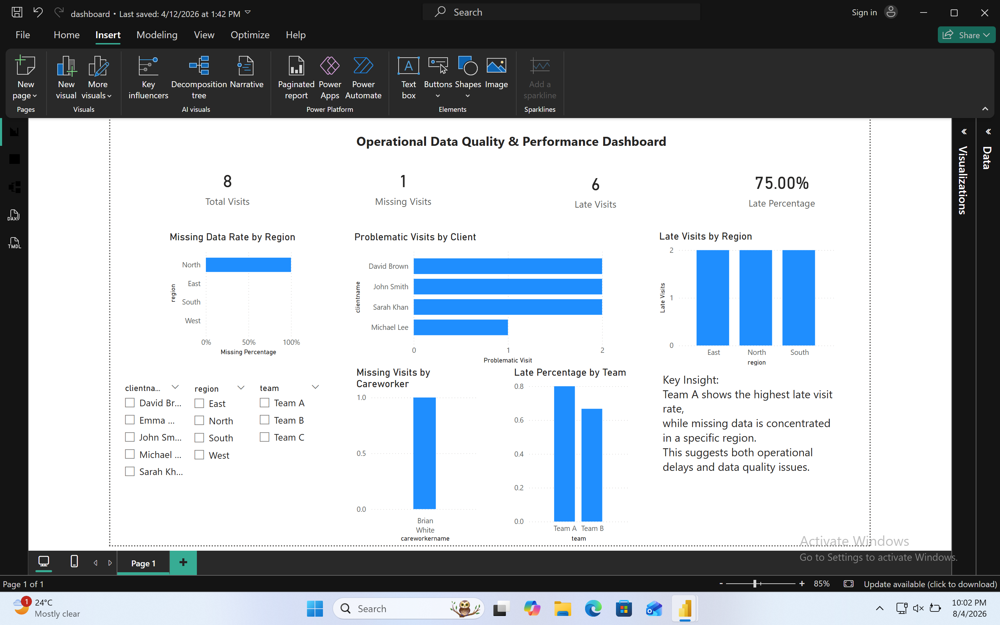

# Healthcare Data Quality Dashboard

## Overview

This project analysed healthcare operational data using SQL and Power BI to investigate data-quality issues and identify where incomplete or late reporting was occurring across visits, clients and careworkers. The aim was to help managers understand the scale and location of data-quality problems so they could target follow-up action more effectively.
Analytical Problem
Operational reporting contained missing information and late visit completion records, making it difficult to identify where data-quality issues were concentrated and which teams required attention.

What I Did
- Used SQL to identify missing and incomplete records using conditional logic
- Analysed visit and completion timestamps to identify late reporting
- Joined visit, client and careworker data to investigate patterns across teams and regions
- Built measures for Missing Data Rate, Late Visit Rate and Problematic Visits
- Created a Power BI dashboard with interactive filters so users could investigate issues by team, region and client
- Used Excel for initial data preparation and validation

Key Metrics

- Total Visits
- Missing Data Rate
- Late Visit Rate
- Problematic Visits

Tools

SQL — joins, aggregation, CASE WHEN
Power BI — data modelling, DAX measures, dashboards
Excel — data preparation and validation

Business Value

The dashboard made it easier to identify where data-quality issues were occurring and distinguish between missing information and late reporting, helping managers focus monitoring and improvement activity on the areas with the highest level of problems.

## Dashboard Preview

